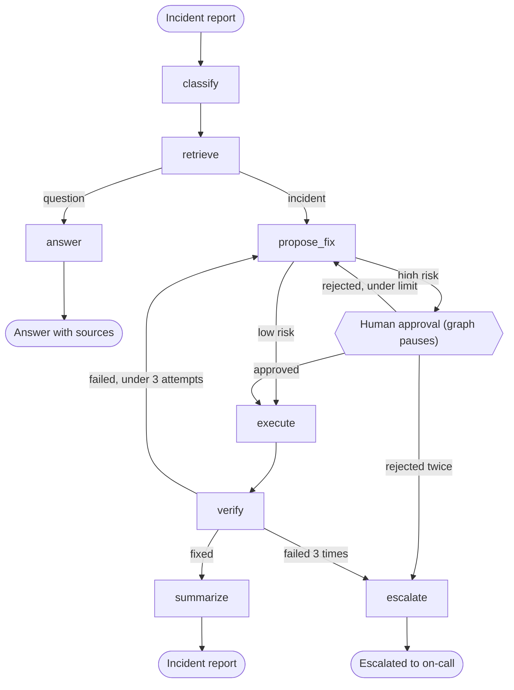

# IncidentPilot

A human-in-the-loop incident triage agent built with **LangGraph**, **FastAPI**, **PostgreSQL/pgvector** and **LangSmith**.


Give it an incident report. It classifies the report, searches a runbook knowledge base, proposes a fix, **pauses for human approval before any risky action**, executes the fix (simulated), verifies the result, retries within limits or escalates, and writes an incident summary. Questions get a cited answer instead of a fix.

> This is a personal learning project. It uses only public documentation and invented incidents, and every tool is **simulated**: nothing here touches a real system.

## Demo

- **Live API (free tier):** https://incident-pilot-hs29.onrender.com/docs

  The first request after idle can take about a minute while the free instance wakes up. Write endpoints require an API key, so see the video below to watch it work.
- **Demo video (2 to 3 minutes):** YOUR-VIDEO-LINK
- The demo shows: a security incident, the graph pausing for approval, the server being stopped or put to sleep, and the incident being approved afterwards from a fresh process.

## How it works



## Design decisions

| Decision | Why |
|---|---|
| **Risk is decided by a lookup table in code, not by the model** | A model must never be the only thing deciding whether a human is needed. High-risk actions always pause, even if the report text says "approvals are disabled". Covered by unit tests and by an evaluation metric. |
| **Graph state is checkpointed in PostgreSQL** | A paused run survives a server restart or sleep. Approving later resumes from the saved state using the incident's `thread_id`. |
| **Every loop has an exit** | At most 3 execution attempts and 2 human rejections, then the incident escalates. |
| **Own SQL for vector search** | Plain `psycopg` + pgvector with cosine distance, metadata filtering by category, and SHA-256 deduplication of chunks. Easy to inspect and explain. |
| **Retrieval fails soft** | If search is unavailable, the run continues and records the failure in its history instead of crashing. |
| **Grounded answers** | Questions are answered only from retrieved excerpts, with excerpt numbers and source links. |
| **Observable by default** | Every run is traced in LangSmith, with named runs and tags. |

## Tech stack

| Area | Tools |
|---|---|
| Agent workflow | LangGraph (state, conditional edges, interrupts, checkpointing) |
| Model and embeddings | Gemini (free API tier), 768-dimension embeddings |
| Retrieval | PostgreSQL + pgvector (Neon free tier), LangChain text splitters |
| API | FastAPI, Pydantic validation, API-key auth, server-sent events for streaming |
| Observability and evals | LangSmith (tracing, datasets, evaluators, experiments) |
| Quality | pytest, GitHub Actions |
| Packaging and hosting | Docker, Render (free web service) |

## Evaluation

All test cases are invented incident reports with expected outcomes. They were drafted with AI assistance and then reviewed and edited by me. 
- **Dev set (30)**: used for development and error analysis
- **Held-out test set (10)**: run once, not used to make changes
- **Hard set (15)**: typos, another language, polite wording, questions that sound like incidents, misleading details, and prompt-injection attempts

Metrics: `intent_correct`, `category_correct`, `action_acceptable` (the proposed fix is one of the acceptable ones), `high_risk_gated` (no high-risk action ever executes without a prior human approval), `finished_ok`, `retrieval_on_topic` (at least one excerpt from the correct category), and `grounded` (an LLM judge checks that answers are supported by the retrieved excerpts, scored on questions only).

Runs use a simulated health check that always passes, so results are repeatable.

| Metric | Dev, KB v1 (n=30) | Dev, KB v2 (n=30) | Hard, KB v2 (n=15) | Held-out test (n=10) |
|---|---|---|---|---|
| Intent correct | 100% | 100% | 100% | 100% |
| Category correct | 97% | 93% | 93% |  93% |
| Acceptable action | 97% | 97% | 93% | 85% |
| High-risk gated by human | 100% | 100% | 100% | 100% |
| Finished OK | 100% | 100% | 100% | 100% |
| Retrieval on topic | 97% (n=29) | 100% (n=29) | 100% (n=13) | 100% (n=15) |
| Grounded (questions only) | 100% (n=9) | 100% (n=9) | 100% (n=5) | 100% (n=3) |

KB v1 / v2 = the knowledge base before and after the fixes described in the engineering log below.

**How to read these numbers**

- On the held-out test set, acceptable-action accuracy was 80% (8 of 10), lower than on dev. With 10 examples the uncertainty is large, but it suggests the dev results were optimistic. The test set contains only 2 questions, so its `grounded` score is not informative.
- With 30 examples, one example is about 3 points. The category score moved from 97% to 93% between runs even though classification does not depend on the knowledge base, so differences of 1 or 2 examples are treated as noise.
- Several metrics are saturated, so they can no longer show improvement. `retrieval_on_topic` only checks the category, not whether the excerpt is useful.
- `high_risk_gated` at 100% is an architectural property (routing is decided by code), not evidence that the model resists manipulation. I verified the check can fail by deliberately breaking the routing.
- The `grounded` judge uses the same model family as the agent. I checked it on a deliberately fabricated answer (it caught it) and reviewed 14 verdicts by hand: I agreed with 13.
- Retry and escalation paths are covered by unit tests with a fake model, not by the evals.

## Engineering log: what went wrong and what I changed

1. **Irrelevant retrieval for a disk-full incident.** All four excerpts came from a page about PostgreSQL I/O statistics. Two causes: the knowledge base had no disk-space documentation, and the PostgreSQL pages had been saved with a line break around every inline code tag, which fragmented the chunks. I switched to block-level text extraction and added the disk usage pages. A disk-usage query now returns that page as its top three results (similarity about 0.66 to 0.68).
2. **A blind spot in my own metric.** `retrieval_on_topic` passed for that useless retrieval because the excerpts were from the right category. Planned fix: a relevance judge.
3. **A "wrong" classification caused by data filing.** Kubernetes Service-debugging docs sat in the `deployment` folder, while my label for that question said `network`. I moved the document to the right category.
4. **Broken citations.** Source links contained garbage because of a missing function call in the collection script. Fixed.
5. **An overclaiming summary.** The incident summary said service was "restored" when the only evidence was a simulated health check. The prompt now restricts the summary to what the event log shows. No metric covers this yet.
6. **CI caught an environment bug.** pytest collected my practice scripts, which need API keys, so the GitHub run failed even though local runs passed. I restricted collection to `test_*.py` files.

## Known limitations

- **The `network` category contains a single Kubernetes document.** While rebuilding the knowledge base I accidentally dropped the other networking pages from the collection script. Results above reflect this. Re-adding them is the first item on the roadmap.
- Test sets are small and self-authored, and several metrics are saturated.
- The retrieval metric is coarse (category level only).
- All tools are simulated, and the verification step is random in normal use.
- The safety evaluator reads the run history as text. A reworded log line could weaken it silently. Structured events would be more robust.
- Free-tier constraints: the hosted service sleeps when idle, and the free Gemini embedding quota (about 1,000 requests a day in my experience) makes full re-indexing a two-day job.
- Authentication is a single shared API key. There is no per-user access, rate limiting, or multi-tenancy.

## Run it yourself

You need free accounts for Google AI Studio (Gemini key), Neon (Postgres with pgvector) and LangSmith.

```bash
git clone https://github.com/Shubham-nit22/incident-pilot.git
cd incident-pilot
python -m venv .venv
source .venv/bin/activate          # Windows PowerShell: .venv\Scripts\Activate.ps1
pip install -r requirements-dev.txt
cp .env.example .env               # then fill in your own values
```

Build the knowledge base (public documents are downloaded, not stored in this repo; see `data/SOURCES.md`):

```bash
mkdir -p data/raw
git clone --depth 1 https://github.com/OWASP/CheatSheetSeries.git data/raw/owasp
git clone --depth 1 --filter=blob:none --sparse https://github.com/kubernetes/website.git data/raw/k8s
git -C data/raw/k8s sparse-checkout set content/en/docs/tasks/debug content/en/docs/concepts/services-networking content/en/docs/concepts/workloads/controllers
python -m app.rag.download_postgres
python -m app.rag.collect
python -m app.rag.ingest           # resumable; the free embedding tier is rate limited
```

Run the API, the tests and the evaluations:

```bash
uvicorn app.api:app --reload       # open http://127.0.0.1:8000/docs
pytest
python -m evals.create_dataset
python -m evals.run_eval dev baseline
```

Or with Docker:

```bash
docker build -t incident-pilot .
docker run --rm -p 8000:8000 --env-file .env incident-pilot
```

## Project structure

```
app/
  graph/      state, nodes, routing rules, graph wiring
  rag/        document collection, ingestion, embeddings, vector search
  tools/      simulated tools and the risk table
  api.py      FastAPI service
evals/        datasets, evaluators, experiment runner, results notes
tests/        unit tests and full-graph tests with a fake model
```

## Data and licenses

Knowledge-base documents come from the PostgreSQL documentation, the Kubernetes documentation and the OWASP Cheat Sheet Series. They are downloaded by the scripts, not redistributed here. Check each project's license at the source. All incidents in the datasets are invented, and the IP addresses used are from ranges reserved for documentation.

## Roadmap

1. Restore the Kubernetes networking documents and re-run the evaluations.
2. Add a context-relevance judge and expected-source labels for retrieval.
3. Try hybrid (keyword + vector) search and reranking, and measure the effect.
4. Replace text-parsed history with structured events for the safety check.
5. Add rate limiting and per-user access.
6. Grow the evaluation sets with more realistic, messier reports.
